<div align="center">
  
  <h1>tetra_config</h1>
  <p><b>TETRA 로봇 6종의 브링업 · 매핑(SLAM) · 자율주행(Nav2) 런치와 파라미터</b></p>
  
  
  
  
</div>

> 이 레포는 [tetra_integration](https://github.com/TETRA-ROBOT/tetra_integration) 의 서브모듈입니다 (`ros/src/tetra_config`). 전체 시스템 설명, 설치, 웹 관제는 상위 레포 README 를 보세요.

## 한눈에 보기

- 로봇을 켜는 순서는 늘 같습니다: **① 브링업**(드라이버·센서·TF) → **② 매핑**(SLAM 으로 지도 그리기) → **③ 지도 저장** → **④ 주행**(AMCL 위치 추정 + Nav2).
- 이 레포에는 코드가 거의 없고, 그 순서에 필요한 **런치 파일과 파라미터(YAML·Lua)** 가 모델별로 들어 있습니다.
- 현장에서는 보통 직접 런치하지 않습니다. `scripts/start_real_robot.sh` 가 ①을 띄우고, ②~④는 웹 관제 버튼이 이 레포의 런치를 대신 실행합니다.
- 직접 실행하는 경우(점검, 튜닝, RViz 로 보기)를 위해 아래에 모델별 명령과 인자를 모았습니다.

## 🚀 빠른 시작

실 로봇 PC 에서 **ROS 스택이 아직 안 떠 있을 때만** 실행하세요. 같은 드라이버가 두 개 뜨면 한 보드 포트를 두 프로세스가 열어 통신이 깨집니다.

1. 환경을 불러옵니다.
   ```bash
   source /opt/ros/jazzy/setup.bash
   source ~/tetra_integration/ros/install/setup.bash
   ```
2. 브링업 (모델을 고릅니다: `m` `h` `edu` `mh` `s` `sm`).
   ```bash
   ros2 launch tetra_bringup tetra_bringup.launch.py robot_model:=m
   ```
3. 다른 터미널에서 저장된 지도로 주행을 띄웁니다. 지도는 `persistent/maps/` 에 있는 파일 이름(확장자 포함)으로 줍니다.
   ```bash
   ros2 launch tetra_navigation2 tetra_navigation_m.launch.py map_name:=office.yaml
   ```

> 평소 운영은 상위 레포의 `./scripts/start_real_robot.sh start` 를 씁니다. 모델·런치 인자는 `~/.config/tetra/robot.env`(`setup_robot.sh` 가 만듦)에서 읽습니다.

## 📦 구성

| 패키지 | 하는 일 | 주요 파일 |
|---|---|---|
| [`tetra_bringup`](tetra_bringup/) | 모델별 브링업: 바퀴·전원 보드, IMU, 라이다, 카메라, URDF(TF), EKF, rosbridge(9090), web_video_server(8080) | `launch/tetra_bringup_<모델>.launch.py`, `launch/bringup_common.py`, `params/ekf_<모델>.yaml` |
| [`tetra_navigation2`](tetra_navigation2/) | Nav2 주행, AMCL, SLAM Toolbox 매핑, 경로 지정 주행(Route Server), 자동 위치 재추정 | `launch/tetra_navigation_<모델>.launch.py`, `params/navigation_<모델>.yaml`, `params/amcl_localization_<모델>.yaml` |
| [`tetra_cartographer`](tetra_cartographer/) | Cartographer 2D 매핑 (EDU 기본 엔진) | `launch/cartographer_mapping.launch.py`, `config/tetra_lds_2d.lua`, `config/tetra_edu_2d.lua` |
| `tetra_rtabmap` | RTAB-Map 3D 매핑·위치 추정 (Livox MID-360) | `launch/tetra_rtabmap.launch.py`, `config/rtabmap_params.yaml` |

## 🧭 모델별 런치 선택표

패키지 이름은 줄였습니다: **bringup** = `tetra_bringup`, **nav2** = `tetra_navigation2`, **carto** = `tetra_cartographer`.

| 모델 | ① 브링업 | ② 매핑 (웹 관제 기본 엔진) | ④ 주행 | 3D (Livox MID-360) |
|---|---|---|---|---|
| **M** | bringup `tetra_bringup_m.launch.py` | SLAM Toolbox · `slam_toolbox.yaml` | nav2 `tetra_navigation_m.launch.py` | bringup `tetra_3d_bringup.launch.py` ※ |
| **H** | bringup `tetra_bringup_h.launch.py` | SLAM Toolbox · `slam_toolbox_h.yaml` (`/scan_merge`) | nav2 `tetra_navigation_h.launch.py` | - |
| **EDU** | bringup `tetra_bringup_edu.launch.py` | **Cartographer** · `tetra_edu_2d.lua` | nav2 `tetra_navigation_edu.launch.py` | - |
| **MH** | bringup `tetra_bringup_mh.launch.py` | SLAM Toolbox · `slam_toolbox_mh.yaml` (`/scan_merge`) | nav2 `tetra_navigation_mh.launch.py` | bringup `tetra_3d_bringup_mh.launch.py` |
| **S** | bringup `tetra_bringup_s.launch.py` | SLAM Toolbox · `slam_toolbox.yaml` | nav2 `tetra_navigation_s.launch.py` | bringup `tetra_3d_bringup_s.launch.py` |
| **SM** | bringup `tetra_bringup_sm.launch.py` | SLAM Toolbox · `slam_toolbox.yaml` | nav2 `tetra_navigation_sm.launch.py` | bringup `tetra_3d_bringup_sm.launch.py` |

- `tetra_bringup.launch.py robot_model:=<모델>` 은 위 표의 2D 브링업을 그대로 include 합니다. 모델별 인자는 같은 줄에 붙이면 하위 런치로 넘어갑니다. 지원하지 않는 모델 이름이면 바로 오류로 끝납니다.
- ※ `tetra_3d_bringup.launch.py` 는 M 몸체 URDF(`m_rear_sonar:=true`)에 `ekf_s.yaml` 을 쓰는 시험용입니다. `start_real_robot.sh start 3d` 가 이것을 띄웁니다.
- 3D 매핑은 `tetra_rtabmap` 으로 합니다 (아래 "3D 매핑" 참고).

<details>
<summary><b>모델별 브링업이 띄우는 센서 (launch 파일 기준)</b></summary>

| 모델 | 라이다 → 스캔 토픽 | IMU | 카메라 | 그 밖 |
|---|---|---|---|---|
| M | 앞 SICK TiM5xx → `/scan`, 뒤 Cyglidar D2(`use_cyglidar`) 또는 초음파(`use_ultrasonic`) | iAHRS → `imu_standstill_gate` → `imu/data_gated` | 후면 usb_cam + AprilTag(모서리 왜곡 보정), RealSense(`use_realsense`, 기본 꺼짐) | rosbridge 메시지 10 MB |
| H | 대각 SICK 2대 → 그림자 필터 → `/scan_filtered_1·2` → `dual_laser_merger` → `/scan_merge` | iAHRS | RealSense `camera1` (점구름 `realsense_pointcloud`) | 리프트 하중 센서(conveyor 옵션) |
| EDU | Kanavi R270 `/points2` → `pointcloud_to_laserscan` → `/scan` | 없음 (바퀴만) | RealSense 컬러(AprilTag, 점구름 끔) | 라이다 V 홈 도킹 검출 `vdock_detector` |
| MH | H 와 같은 대각 SICK 2대 → `/scan_merge` (odom 움직임 보정) | iAHRS | RealSense, Autonics RGB-D(팔 끝 또는 팬틸트) | Herkulex 팬틸트, 리프트, RB10 팔(`use_rb10`), 열화상(`use_thermal_camera`) |
| S | 앞 SICK + 그림자 필터, 뒤 Cyglidar D2 | iAHRS | 후면 usb_cam + AprilTag, RealSense | - |
| SM | Kanavi R270 → `/scan` → `line_extraction_node` | iAHRS | RealSense 컬러(AprilTag 도킹) | 조이스틱 노드 꺼짐 |

모든 모델 공통 (`bringup_common.py`): `robot_state_publisher`, `joint_state_publisher`, `ekf_filter_node`, `robot_pose_publisher`(`/footprint`), `rosbridge_websocket`(9090) + `rosapi`, `web_video_server`(8080).
EKF 주기: M·EDU·S·SM 50 Hz, H·MH 60 Hz (`params/ekf_<모델>.yaml`).
</details>

## 🧭 런치 인자 치트시트

### 모든 브링업 (직렬 포트 자동 탐색)

드라이버를 띄우기 전에 `/dev/ttyS0~5` 에 읽기 전용 명령(버전 조회 `VR`, 오일러각 조회 `e`)을 보내 구동보드·전원보드·IMU 포트를 찾습니다. 다른 프로세스가 연 포트는 건너뜁니다.

| 인자 | 기본값 | 설명 |
|---|---|---|
| `wheel_port` | `auto` | 구동보드 포트. 값을 주면 스캔하지 않음 |
| `power_port` | `auto` | 전원보드 포트 |
| `imu_port` | `auto` | IMU(iAHRS) 포트 |
| `serial_scan_ports` | `/dev/ttyS0,…,/dev/ttyS5` | 스캔할 포트 (쉼표 구분) |
| `use_sim_time` | `false` | |

못 찾으면 모델 기본 포트를 씁니다: EDU 는 구동 `ttyS2`·전원 `ttyS3`, 나머지는 `ttyS0`·`ttyS1`, IMU 는 모두 `/dev/IMU`. 결과는 로그의 `[serial scan] wheel port: …` 줄에 나옵니다.

### M

| 인자 | 기본값 | 설명 |
|---|---|---|
| `use_ultrasonic` | `true` | 구형 M: 뒤 초음파 켜기·발행, URDF 초음파 프레임(`m_rear_sonar`) |
| `use_cyglidar` | `false` | 신형 M: 뒤 Cyglidar D2 |
| `emg_releases_servo` | `use_ultrasonic` 값 | 비상정지 버튼으로 서보 풀기 (뒤 서보 버튼이 없는 구형 M) |
| `use_realsense` | `false` | RealSense (장착된 경우만) |

```bash
# 신형 M (Cyglidar, 초음파 없음)
ros2 launch tetra_bringup tetra_bringup.launch.py robot_model:=m use_cyglidar:=true use_ultrasonic:=false
```

### H · MH (듀얼 SICK)

| 인자 | 기본값 | 설명 |
|---|---|---|
| `front_lidar_hostname` | `192.168.0.1` | 앞 SICK IP |
| `rear_lidar_hostname` | `192.168.0.2` | 뒤 SICK IP |
| `front_lidar_frame` | `laser` | 앞 라이다 TF 프레임 |
| `rear_lidar_frame` | `laser_link2` | 뒤 라이다 TF 프레임 |
| `realsense_pointcloud` | `true` | RealSense 점구름 `/camera1/depth/color/points` (160x120, 15 Hz, 4 m 까지) |

예전 `~/ros2_ws` 로 쓰던 H 는 라이다가 `192.168.0.201`·`.202` 인 경우가 있습니다. `ping` 으로 확인하고 다르면 인자로 줍니다.

### MH 외부 장비

| 인자 | 기본값 | 관련 인자 (기본값) |
|---|---|---|
| `use_realsense` | `true` | |
| `use_herkulex` | `true` | `herkulex_port` (`/dev/ttyS2`) |
| `use_autonics_rgbd` | `true` | `autonics_interface` (`eno1`), `autonics_ip` (`192.168.0.200`), `autonics_uart` (`/dev/ai_camera`), `autonics_pointcloud` (`true`) |
| `use_rb10` | `false` | `rb10_ip` (`10.0.2.7`), `autonics_camera_mount` (`gripper` \| `pantilt` \| `none`), `autonics_gripper_xyz`, `autonics_gripper_rpy` |
| `use_keepalive_relay` | `true` | |
| `use_gpio_controller` | **`false`** | 켜면 GPIO 출력 0~7 을 리프트·팬틸트·팔 명령으로 씁니다. 웹의 범위·충돌 검사를 거치지 않으니 주의 |
| `use_thermal_camera` | `false` | `thermal_pipeline` (GStreamer RTSP 파이프라인, 카메라 `192.168.0.100`) |

```bash
# MH, 팬틸트 없이
ros2 launch tetra_bringup tetra_bringup.launch.py robot_model:=mh use_herkulex:=false
# MH + RB10 로봇팔 (rbpodo_* 패키지는 이 레포 밖: robot.env 의 TETRA_EXTRA_ROS_SETUP 으로 불러옴)
ros2 launch tetra_bringup tetra_bringup.launch.py robot_model:=mh use_rb10:=true
```

<details>
<summary><b>RB10 팔 런치 (<code>rb10_arm.launch.py</code>) 인자</b></summary>

MH 브링업이 `use_rb10:=true` 일 때 include 합니다. 이때 MH 브링업은 자기 `robot_state_publisher` 를 띄우지 않고 몸체+팔 URDF(`tetra_description` `tetra_mh/tetra_rb10.xacro`) 하나로 냅니다.

| 인자 | 기본값 | 설명 |
|---|---|---|
| `robot_ip` | `10.0.2.7` | RB 컨트롤 박스 IP (MH 브링업은 `rb10_ip` 를 넘김) |
| `model_id` | `rb10_1300e` | |
| `use_fake_hardware` / `fake_sensor_commands` | `false` | |
| `cb_simulation` | `Real` | `Real` \| `Simulation` |
| `use_arm_perception` | `true` | 깊이 점군으로 MoveIt octomap 을 만들어 팔 충돌 검사에 넣음 (`params/rb10/sensors_3d.yaml`). CPU 가 모자라면 `false` |

팔 카메라 점군은 기본으로 octomap 에 넣지 않습니다 (ToF 가 렌즈 가까이에 거짓 점을 냄, 2026-11-25 실기). 관제 관리자 옵션 `use_arm_camera_obstacles` 로 켭니다. 자세한 이유는 [CONTEXT.md](CONTEXT.md) 12번.
</details>

### 주행 런치 (`tetra_navigation_<모델>.launch.py`)

| 인자 | 기본값 | 설명 |
|---|---|---|
| `map_name` | `office.yaml` | 지도 YAML 파일 이름. `TETRA_MAPS_DIR`(기본 `~/tetra_integration/persistent/maps`)에서 찾습니다 |
| `use_sim_time` | `False` | |
| `auto_relocalize` | `true` | 위치를 잃으면 스캔을 지도에 맞춰 바로잡는 `auto_relocalizer` (tetra_util) |

> 예전에는 `map_name` 기본값이 등록되지 않아 빼면 런치가 실패했습니다 (2026-11-26 고침).

### 매핑 런치

| 런치 | 인자 | 설명 |
|---|---|---|
| nav2 `slam_launch.py` | `params_file` (기본 `slam_toolbox.yaml`, H·MH 는 `slam_toolbox_<모델>.yaml`), `use_sim_time` (`False`) | SLAM Toolbox(online sync) + `map_saver` |
| carto `cartographer_mapping.launch.py` | `configuration_basename` (기본 `tetra_edu_2d.lua`), `scan_topic` (`scan`, H·MH `/scan_merge`), `resolution` (`0.05`), `publish_period_sec` (`1.0`) | Cartographer + 점유 격자. RViz·고정 TF 없이 웹 관제용 |
| carto `cartographer_<모델>.launch.py` | `use_rviz` (`true`) | 위 런치를 모델 설정(lua·스캔 토픽)으로 include + RViz |
| `tetra_rtabmap` `tetra_rtabmap.launch.py` | `mapping` (`true`), `db_name` (`rtabmap`), `lidar_topic` (`/livox/lidar`), `imu_topic` (`/imu/data`) | RTAB-Map. DB 는 `TETRA_MAPS_DIR/<db_name>.db` |

## 🧭 자주 하는 작업

| 하고 싶은 일 | 명령 |
|---|---|
| 지금 뜬 노드·토픽 보기 | `ros2 node list` / `ros2 topic hz /scan` |
| 2D 지도 그리기 (SLAM Toolbox, M·S·SM) | 아래 "2D 매핑" |
| 지도 저장 | `ros2 run nav2_map_server map_saver_cli -f ~/tetra_integration/persistent/maps/새지도 --ros-args -p save_map_timeout:=10.0` |
| 저장한 지도로 주행 | `ros2 launch tetra_navigation2 tetra_navigation_<모델>.launch.py map_name:=새지도.yaml` |
| 자동 위치 재추정 끄고 주행 | 위 명령 끝에 `auto_relocalize:=false` |
| RViz 로 주행 보기 | `rviz2 -d $(ros2 pkg prefix tetra_navigation2)/share/tetra_navigation2/rviz/tetra_navigation2_m.rviz` |
| 두 SLAM 엔진 비교 | 상위 레포 `./scripts/slam_compare.sh record` → `compare <기록 폴더>` |

### 2D 매핑

SLAM Toolbox (웹 관제가 M·H·MH·S·SM 에서 쓰는 방식과 같음):

```bash
ros2 launch tetra_navigation2 slam_launch.py use_sim_time:=false \
  params_file:=$(ros2 pkg prefix tetra_navigation2)/share/tetra_navigation2/params/slam_toolbox.yaml
```

H·MH 는 `slam_toolbox_h.yaml` · `slam_toolbox_mh.yaml` 을 줍니다 (스캔이 `/scan_merge`).

Cartographer (EDU 기본. 다른 모델은 관리자 설정 → 서비스 → **2D 매핑 엔진**에서 고를 수 있음):

```bash
# EDU (R270 /points2 를 그대로 받음)
ros2 launch tetra_cartographer cartographer_mapping.launch.py
# M·S·SM (/scan 하나)
ros2 launch tetra_cartographer cartographer_mapping.launch.py configuration_basename:=tetra_lds_2d.lua
# H·MH (합친 스캔)
ros2 launch tetra_cartographer cartographer_mapping.launch.py configuration_basename:=tetra_lds_2d.lua scan_topic:=/scan_merge
# 모델 설정 + RViz 를 한 번에
ros2 launch tetra_cartographer cartographer_m.launch.py
```

- Cartographer 로 매핑할 때는 웹 관제의 자동 탐사와 매핑 중 도킹을 쓸 수 없습니다 (Nav2 가 Cartographer 지도의 벽을 빈 칸으로 읽을 수 있음).
- 웹 관제는 `-collect_metrics` 로 읽은 스캔 매칭 점수를 매핑 정확도로 보여 줍니다.

### 3D 매핑 (RTAB-Map, MID-360)

```bash
ros2 launch tetra_bringup tetra_3d_bringup_s.launch.py      # 또는 _mh, _sm
ros2 launch tetra_rtabmap tetra_rtabmap.launch.py mapping:=true db_name:=office3d
```

## 📡 인터페이스

브링업 이후 다른 패키지와 웹 관제가 기대하는 이름입니다 (launch·YAML 에서 확인, M 실기 `ros2 node list` 로 대조).

| 이름 | 종류 | 누가 내나 | 비고 |
|---|---|---|---|
| `/scan` | `sensor_msgs/LaserScan` | 라이다 드라이버 (EDU·SM 은 `pointcloud_to_laserscan`) | H·MH 는 `/scan_merge` 를 씀 |
| `/odom` | `nav_msgs/Odometry` | `tetra_wheel_driver` | EKF 입력 |
| `/imu/data` | `sensor_msgs/Imu` | `iahrs_driver` | M 은 `imu/data_gated` 를 거쳐 EKF 로 |
| `/odometry/filtered` + TF `odom→base_footprint` | `nav_msgs/Odometry` | `ekf_filter_node` | Cartographer 도 이 값을 odom 으로 받음 |
| TF `map→odom` | TF | `amcl` (주행) / SLAM (매핑) | |
| `/footprint` | 로봇 위치 | `robot_pose_publisher` | 웹 관제가 로봇 위치로 씀 |
| `/cmd_vel_nav2` | `geometry_msgs/Twist` | `collision_monitor`, `docking_server` | `tetra_wheel_driver` 가 받음 |
| `/Global_virtual_wall`, `/Local_virtual_wall` | `sensor_msgs/PointCloud2` | 웹 관제 API | costmap 가상벽 레이어 (별도 virtual_wall 노드 없음) |
| `/costmap_filter_info`, `/zone_filter_mask` | costmap filter | 웹 관제 API | PENALTY 구간 (global costmap `zone_keepout_filter`) |
| rosbridge `9090`, web_video_server `8080` | 포트 | 브링업 | 웹 관제 연결 |

Nav2 구성 (모든 2D 모델): 계획기 NavFn, 제어기 Regulated Pure Pursuit (SM 만 MPPI), `collision_monitor`, `docking_server`, `route_server`(별도 lifecycle manager, 설치돼 있을 때만).
복구 BT 는 Spin·BackUp 을 뺀 `behavior_trees/navigate_*_w_replanning_and_recovery.xml` (EDU 는 `_edu.xml`, BackUp 만 뺌).

<details>
<summary><b>모델별 Nav2 footprint · 도착 허용 오차 (params/navigation_&lt;모델&gt;.yaml)</b></summary>

| 모델 | footprint 앞 / 뒤 / 좌우 (m) | 길이 × 폭 (mm) | 제어기 | xy 도착 허용 |
|---|---|---|---|---|
| M | 0.2196 / -0.3955 / ±0.245 | 615 × 490 | RPP | 0.05 m |
| H | 0.434 / -0.504 / ±0.434 | 938 × 868 (뒤 안테나 7 cm 포함) | RPP | 0.1 m |
| EDU | 0.1675 / -0.318 / ±0.215 | 485.5 × 430 | RPP | 0.1 m |
| MH | 0.4 / -0.4 / ±0.29 | 800 × 580 | RPP (0.4 m/s) | 0.05 m |
| S | 0.1675 / -0.318 / ±0.215 | 485.5 × 430 | RPP | 0.05 m |
| SM | 0.1675 / -0.318 / ±0.215 | 485.5 × 430 | MPPI (vx 0.5 m/s) | 0.1 m |

장착물이 차체 밖으로 나오면 footprint 와 collision_monitor 정지 다각형을 같이 늘립니다 (H 는 후진하다 뒤 안테나가 부서진 뒤 -0.504 m 로 늘림).
</details>

## 📊 벤치마크

### 지금 실기 토픽 주기

2026-11-26, TETRA-M 실기, 정지·대기 상태, Nav2 위치 추정 실행 중, i7-10700, rclpy 구독 20초.

| 토픽 | 주기 | 주기 흔들림 (표준편차) |
|---|---|---|
| `/odometry/filtered` (EKF 출력, 설정 50 Hz) | 49.5 Hz | 10.4 ms |
| `/odom` (바퀴) | 30.0 Hz | 2.8 ms |
| `/imu/data` (iAHRS) | 98.6 Hz | 0.9 ms |
| `/scan` (SICK TiM5xx) | 15.0 Hz | 19.1 ms |
| `/tf` | 81.9 Hz | 8.7 ms |
| `/footprint` | 10.0 Hz | 0.6 ms |

`/amcl_pose` 는 로봇이 서 있으면 내지 않습니다 (AMCL 은 움직였을 때만 갱신).

### 설정을 바꾸게 한 실기 측정

레포의 커밋 메시지와 YAML 주석에 남은 값입니다. 괄호는 측정일 · 모델 · 출처.

| 항목 | 바꾸기 전 | 바꾼 뒤 | 출처 |
|---|---|---|---|
| EKF 방향 오차 (SLAM 대비 RMS, 자동 탐사 5분) | IMU 우선 38°, 회전 process noise 기본값 19° | 바퀴 우선 **3.5°** | 2026-11-17 · M · `ekf_m.yaml` |
| 정지 중 EKF 방향 흐름 | -6.3°/h (몇 시간 뒤 AMCL 위치 잃음) | IMU 정지 게이트로 차단 | 2026-11-20 · M · `ekf_m.yaml`, 9e8cc03 |
| AMCL 42시간 운전 뒤 | 0.25 m · 12° 어긋남, 스캔 일치 23 % (맞는 자세 87 %) | `likelihood_field_prob` + 파티클 주입 끔 | 2026-11-19 · M · 194dd90 |
| AMCL 스캔-지도 일치율 | 37 % | 약 **90 %** | 2026-10-29 · EDU · d7e39df |
| 목표 도착 오차 (8회) | 9~10 cm 앞에서 멈춤 (허용 0.1 m) | **2.5~3.4 cm** (허용 0.05 m) | 2026-11-25 · MH · 919df7c |
| 합친 스캔 유효 빔 | 6284칸 중 85 % 가 inf, AMCL 유효 빔 약 7개 | 0.333° 간격 (`angle_increment 0.005818`) | 2026-11-20 · MH · 2243a63 |
| `/scan_merge` 버림 (매핑 중) | 초당 1.6번, 15 → 12 Hz | 0번 (`tolerance 0.1`) | 2026-11-24 · MH · 7acc53b |
| 지도 바깥 벽 어긋남 | 0.3~0.5 m, 이중 벽 | EKF 회전을 IMU 로 | 2026-11-24 · MH · `ekf_mh.yaml` |
| 태그 도킹 | 접점 각도 오차 7~9° (실패) | 3회 모두 충전, **0.1~0.5°** | 2026-10-29 · EDU · 1ac224a |
| 태그 도킹 반복 | - | 언도킹→도킹 **5회 연속 성공**, 회당 10~20초 | 2026-11-10 · M · 2c5a3c5 |
| 태그가 시야 밖인 staging 에서 도킹 | 바로 실패 | 찾아서 **25초** 만에 도킹·충전 | 2026-11-18 · MH · a0d9a60 |
| 라이다 V 홈 도킹 검출 (녹화 9회, 접촉 2초 전) | - | 좌우 p90 1.3 cm, yaw 중앙 1.8° · p90 5.5° | 2026-11-19 · EDU · `navigation_edu.yaml` |
| 대기 중 CPU (가상벽이 광선으로 지움) | controller_server 33 %, planner_server 25 % | 가상벽을 표시 전용 레이어로 | 2026-11-10 · EDU · 0b40f9b |

SLAM Toolbox 와 Cartographer 의 지도 비교 결과(`slam_compare.sh compare` 의 `compare.png`)는 아직 이 PC 에 남은 것이 없어 싣지 않았습니다.

## 🛠 문제 해결

<details>
<summary>브링업 로그에 <code>[serial scan] wheel port: … (not found, model default)</code></summary>

스캔에서 보드를 못 찾아 모델 기본 포트를 썼다는 뜻입니다. 이전 드라이버가 아직 포트를 잡고 있으면(다른 프로세스가 연 포트는 건너뜀) 못 찾습니다. `ros2 node list` 로 남은 드라이버를 확인하거나 `wheel_port:=/dev/ttyS0` 처럼 직접 줍니다.
</details>

<details>
<summary>H·MH 에서 <code>/scan_merge</code> 가 안 나옴</summary>

두 SICK 의 IP 가 기본값(`192.168.0.1`·`.2`)과 다른지 `ping` 으로 확인하고 `front_lidar_hostname:=`, `rear_lidar_hostname:=` 로 줍니다.
</details>

<details>
<summary>H·MH 에서 Cartographer 매핑이 지도를 못 그림</summary>

`tetra_lds_2d.lua` 는 스캔 하나를 받습니다. H·MH 는 `/scan_merge` 만 내므로 `scan_topic:=/scan_merge` 를 줘야 합니다. 웹 관제와 `cartographer_h`·`cartographer_mh.launch.py` 는 2026-11-26 부터 알아서 넘깁니다.
</details>

<details>
<summary>AMCL 이 실기에서 시간 0 으로 멈춤</summary>

AMCL YAML 에 `use_sim_time` 을 쓰면 런치의 `-p use_sim_time` 보다 우선합니다 (2026-11-19 확인). `amcl_localization_*.yaml` 에 넣지 않습니다.
</details>

<details>
<summary>예전 3D 주행·지도 없는 주행·모델별 Cartographer 런치가 뜨지 않음</summary>

2026-11-26 전 버전은 없는 `virtual_wall` 패키지·`params/navigation.yaml`, `occupancy_grid.launch.py`·`rviz/tetra_cartographer.rviz` 를 찾아 뜨지 않았습니다.
지금은 3D 주행이 `navigation_<모델>.yaml`(공용 `tetra_3d_navigation` 은 `navigation_s.yaml`, `params_file:=` 로 바꿈), 지도 없는 주행이 `nomap_navigation_<모델>.yaml` 을 쓰고,
가상벽은 웹 관제가 내는 `/Global_virtual_wall`·`/Local_virtual_wall` 을 costmap 이 바로 읽습니다. 3D 주행은 RTAB-Map 이 설치된 로봇에서 아직 실기로 확인하지 않았습니다.
</details>

## 📚 더 보기

- [CONTEXT.md](CONTEXT.md): 설정마다 왜 그렇게 정했는지 (EKF, AMCL, 도킹 속도, collision_monitor, MH 점구름·로봇팔 등 실기 기록)
- [tetra_bringup/README.md](tetra_bringup/README.md), [tetra_cartographer/README.md](tetra_cartographer/README.md), [tetra_navigation2/README.md](tetra_navigation2/README.md): 패키지별 예전 설명
- URDF·TF 프레임: [tetra_description](https://github.com/TETRA-ROBOT/tetra_description)
- 자동 위치 재추정·IMU 정지 게이트·도킹 플러그인: `tetra_util` 레포 (상위 레포 `ros/src/tetra_util`)

## 라이선스

Apache-2.0. [LICENSE](LICENSE) 를 보세요.
